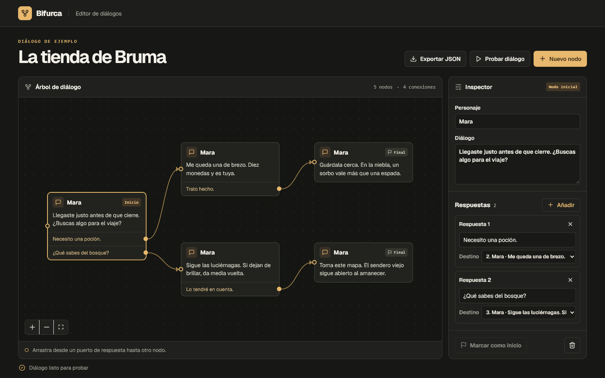

# Bifurca

Editor visual de diálogos ramificados para videojuegos, hecho con React, TypeScript y Vite. Abre con **La tienda de Bruma**, una conversación de RPG con dos rutas y dos finales.

[Probar la demo en el navegador](https://humiumii.github.io/bifurca/) · [Descargar la versión offline](https://github.com/Humiumii/bifurca/releases/latest)



## Ejecutar en local

Requiere Node.js 22.12+ o 24 y npm. Desde la carpeta del proyecto:

```sh
npm ci
npm run dev
```

Abre la URL que imprime Vite. Para generar la versión autónoma, ejecuta `npm run build` y abre `dist/index.html` directamente en tu navegador. La edición y la simulación funcionan sin conexión.

## Editar y probar una ruta

1. Pulsa **Nuevo nodo**, escribe el personaje y el diálogo en el inspector y arrastra el nodo para moverlo. Usa **Encuadrar árbol** si queda fuera de vista.
2. Selecciona un nodo de origen y pulsa **Añadir** para crear una respuesta. Arrastra desde su puerto derecho hasta el puerto izquierdo del destino, o elige el destino en el inspector.
3. Selecciona un nodo y pulsa **Marcar como inicio**. En **Probar diálogo** puedes seguir las respuestas y reiniciar desde el inicio. Un nodo sin respuestas termina la ruta.
4. Pulsa **Exportar JSON** para descargar el diálogo. Las ediciones viven en memoria durante la sesión. Al recargar se abre el ejemplo original.

## Decisiones técnicas

- `src/dialogue.ts` define el documento, sus nodos y las respuestas. Cada respuesta tiene un ID propio y un `targetId` que referencia el siguiente nodo. Se exporta un esquema con `version: 1`.
- React Flow proyecta el documento como nodos, puertos y aristas. La selección y las coordenadas viven en el estado de la interfaz. El JSON exportado contiene el modelo narrativo.
- Al borrar un nodo, el modelo elimina sus respuestas y deja en `null` las referencias entrantes. El editor muestra las conexiones pendientes y, si se borra el inicio, pide marcar otro nodo.
- El simulador recorre el modelo con un diálogo modal nativo. El build empaqueta HTML, estilos, JavaScript y tipografía en un solo archivo.

El historial de PRs registra la evolución desde el modelo hasta la primera entrega. [Ver los PRs integrados](https://github.com/Humiumii/bifurca/pulls?q=is%3Apr+is%3Amerged).

